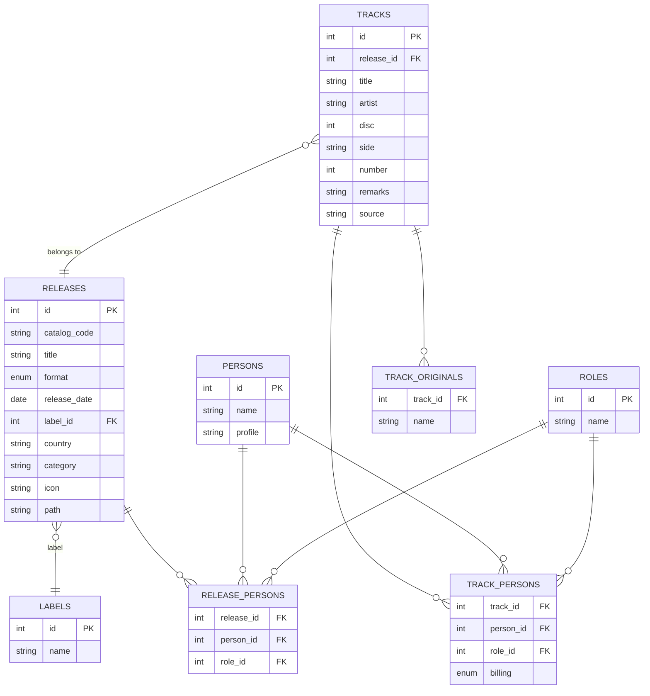

# BEATLES DB スキーマ設計・ER図（人物統合案）

`data/data.json` の370行・32列を、リリースと曲、人物と役割に分けた形です。列の意味は [source_table.md](source_table.md) にあります。

元データは1行が「あるリリースに入っている1曲」です。同じ曲名がシングルとアルバムの両方にあれば、曲は2行です。曲そのものをリリースから切り離したテーブルは置きません。

---

## 設計方針

- 1リリースに複数曲。曲は必ず1つのリリースに属する。
- リリースの識別はカタログ番号（`order`）だけで、59件になる。番号の文字は format と一致する。`A` は Album、`S` は Single、`E` は EP、`CA` は編集盤、`LA` はライブ盤。
- レーベルはリリースから1つ。`label` に複数の値はない。
- 人物は `persons` にまとめ、何をしたかは `roles` と中間テーブルで持つ。
- `format` は Album、Single、EP の3つだけなので ENUM または定数にする。映画と MV はこの値には出てこない。
- 備考と情報源は、関係に分けず曲の文字列として残す。

---

## ER図

`billing` は `primary` と `secondary` です。`profile` は元データに列がないので空で始めます。

---

## テーブル

- `releases` … 59件。`catalog_code` は元の `order`（`BE-A-01` など）。SQL の `ORDER` と重なるので、列名は `catalog_code` にする。`release_date` は `date`。`year` は常にその日付の年なので、列にはしない。`category`、`icon`、`path` は6組で一緒に動く。表示に使うので3つとも残す。
- `labels` … `Apple` から `Regal Starline` まで6件。
- `tracks` … 370行。`title` は元の `track`。`disc`、`side`、`number` は曲の位置。`artist` は表示用の文字列で、`persons` には結び付けない。`John Lennon/Plastic Ono Band` の `/` は名前の一部なので分割しない。同じリリースでも曲が違うのは2件（`TB-CA-01`、`JY-S-04`）だけなので、リリース側には置かない。
- `persons` … クレジットに出てくる名前。`Lennon-McCartney` はハイフンで John と Paul に分けない。元の表記のまま1人として入れる。
- `roles` … `rhythm guitar`、`lead vocals`、`photography`、`songwriter`、`producer`、`engineer`、`film director`、`mv director` など。
- `track_persons` … 曲ごとの「誰が何をしたか」。1人が複数の役割を持つときは、役割の数だけ行を作る。
- `track_originals` … 元の `original`。`The Beatles` や `traditional`、`Carl Perkins` のように、作詞作曲者とは別の「誰の曲か」です。`/` で複数あるときは複数行にする。人物テーブルには入れない。
- `release_persons` … リリース全体で共通のアートワーク。`Angus McBean : photography` の形です。

---

## 列の行き先

| 元の列 | 行き先 |
| --- | --- |
| id | 取り込みの対応用。リリースの id には使わない |
| year, date | `releases.release_date` |
| icon, category, path, country, title | `releases` |
| order | `releases.catalog_code` |
| label | `labels` |
| format | `releases.format` |
| artist | `tracks.artist` |
| disc, side, number, track | `tracks` |
| remarks, source | `tracks` の文字列。`/` では分割しない |
| original | `track_originals` |
| john, paul, george, ringo, musician | `track_persons` |
| vocal | 下の規則どおり `track_persons` |
| songwriter, producer, engineer | `track_persons` |
| playing | 入れない |
| artwork | `release_persons`。同じリリースでは全曲とも同じ文字列 |
| film, mv | `track_persons` |

`remarks` の `/` は文の区切りです。`source` に中身があるのは1行で、URL の中の `/` はパスです。

---

## 人物と役割の分け方

区切りは3つです。`|` は元データにありません。

- `/` は、複数の人、または複数の原曲クレジット。
- ` : ` は、`musician` と `artwork` にある「人物 : 役割」。
- `,` は、その1人が持つ複数の役割。`rhythm guitar, backing vocals` は2行になる。

`playing` は役割のない人名だけで、`john` / `paul` / `george` / `ringo` / `musician` と同じ事実です。役割がある側だけを `track_persons` に入れます。

`vocal` の `(John Lennon)` のように、`/` で分けた全体が括弧なものは `billing = secondary` です。括弧なしは `primary` です。同じ人のパート列に、すでに vocal を含む役割があるときは、括弧なしの側は足しません。括弧の中は、パート列だけでは主と補助が残らないので足します。`Uncredited (played by the Beatles) : tambourine` のように、名前の途中にある括弧は補助クレジットではありません。

`songwriter` も同じです。`Lennon-McCartney / John Lennon / (Paul McCartney)` は3行で、役割はすべて `songwriter`、括弧だけ `secondary` です。

`film` と `mv` は作品の種類ではなく、その曲の監督です。アルバムの中の1曲にだけ入っているので、リリースには付けません。`The Beatles / Bernard Knowles` は2人です。役割は `film director` と `mv director` に分けます。

アートワークは、そのリリースの全曲で同じ文字列です。`release_persons` に1組だけ入れます。空のリリースは、アートワークの行を作りません。
